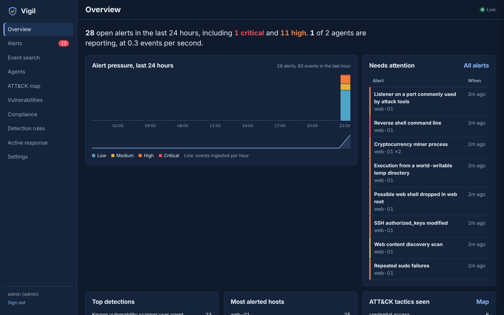

# Vigil

Open, self-hosted security monitoring in the spirit of Wazuh: endpoint agents plus a central server that detects threats with **Sigma rules**, correlates attacks, finds vulnerable packages, checks configuration baselines, maps everything to **MITRE ATT&CK** and compliance controls, and **responds automatically** (block an IP, kill a process, quarantine a file).

Two single binaries, written in Go with no third-party dependencies. The dashboard is embedded in the server.



See **[docs/ARCHITECTURE.md](docs/ARCHITECTURE.md)** for the full design, security model and scaling path.

## Features

- **Agents** for Linux, Windows and macOS: log tailing (rotation-safe, offline spool), file integrity monitoring (SHA-256, realtime on Linux, text diffs), process and listening-port monitoring, Windows Event Log/Sysmon, software inventory, configuration assessment (CIS-inspired), active response
- **Agentless** syslog receiver for firewalls and network gear
- **Detection**: Sigma rules with modifiers, wildcards and full conditions, plus Sigma v2 correlation (`event_count`, `value_count`); 37 bundled rules; hot reload; write and test rules in the UI
- **Decoders** for syslog, sshd, sudo, PAM, user management, nginx/Apache, auditd and JSON
- **Alerts** with dedup, severity scores, ATT&CK techniques, PCI DSS / HIPAA / NIST 800-53 / GDPR / ISO 27001 mapping, triage workflow, notes, CSV export, webhook and email notifications
- **Vulnerability detection** with dpkg-correct version ordering
- **Security**: TLS with certificate pinning, per-agent tokens, RBAC (viewer/analyst/admin), PBKDF2 passwords, login throttling, audit log, strict CSP
- **Central config** pushed to agent groups

## Quick start

```bash
make test server agent           # or: go build ./cmd/...

# 1. server (prints the enrollment key and TLS fingerprint)
VIGIL_ADMIN_PASSWORD='choose-a-long-password' ./bin/vigil-server -data ./data -rules ./rules
# open https://localhost:8443 and sign in as admin

# 2. agent on a host to monitor (as root)
sudo mkdir -p /etc/vigil
sudo tee /etc/vigil/agent.yml <<EOF
server: https://YOUR-SERVER:8443
enrollment_key: <from server log or Settings>
server_fingerprint: <from server log or Settings>
EOF
sudo ./bin/vigil-agent -config /etc/vigil/agent.yml
```

Docker: `docker compose -f deploy/docker/docker-compose.yml up -d`.

Cross-compile every agent: `make agents`.

## Try it in a lab

On a disposable VM running an agent that tails the given files and watches the given directory:

```bash
scripts/simulate-attacks.sh /var/log/auth.log /var/log/nginx/access.log /home 127.0.0.1:5514
```

Within about 30 seconds you should see brute force, password spraying, privilege escalation, web attacks, a web shell, a miner, a reverse shell and a suspicious listener. The brute-forcing IP gets blocked automatically and the malicious processes are killed.

## Writing a rule

```yaml
title: Suspicious wget to /tmp
id: custom-0001
level: medium
tags: [attack.command-and-control, attack.t1105]
logsource: {product: linux, category: process_creation}
detection:
  selection:
    process.name: wget
    CommandLine|contains: ' -O /tmp/'
  condition: selection
response:            # optional automatic response
  action: kill_process
  args: {pid: process.pid}
```

Save it in Detection rules → New rule, or drop it into `data/rules/` and reload.

## Status

This is a working MVP, tested end to end. Before production use, read §8 of the architecture document: replace the sample CVE feed with OSV/OVAL data, put events into ClickHouse or OpenSearch for large fleets, and add eBPF process telemetry. The dashboard loads the Atkinson Hyperlegible font from Google Fonts and falls back to system fonts offline; self-host the font for air-gapped sites.

## License

Choose one before publishing (Apache-2.0 is a common choice for security tooling). Bundled rules follow the Sigma format; rules imported from SigmaHQ keep their Detection Rule License (DRL 1.1).
