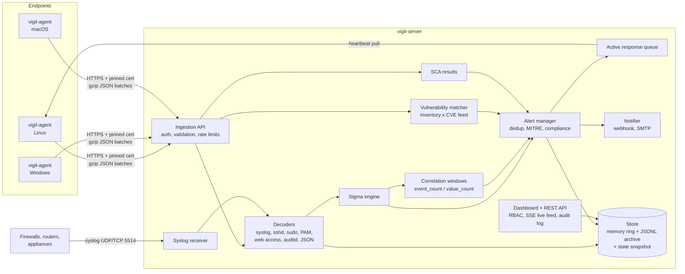

# Vigil architecture

Vigil is an open, self-hosted security monitoring platform in the same family as Wazuh: lightweight endpoint agents ship telemetry to a central server that decodes it, runs detection rules, correlates, scores exposure, and can respond automatically. This document describes how the MVP in this repository is built, why it is built that way, and how each part grows into a production system.

## 1. System overview



Two binaries, no external dependencies:

| Binary | Size | Role |
|---|---|---|
| `vigil-server` | ~8 MB | Manager: ingestion, detection, correlation, storage, API, embedded dashboard, syslog receiver |
| `vigil-agent` | ~7 MB | Endpoint: logs, file integrity, processes, ports, inventory, configuration assessment, response actions |

Both are pure Go standard library (no third-party modules), so the supply chain to audit is the Go toolchain itself, and both cross-compile to Linux, Windows and macOS on amd64 and arm64.

## 2. Wazuh feature map

| Wazuh capability | Vigil component | Status in MVP |
|---|---|---|
| Agent enrollment (authd) | `POST /api/agent/enroll`, shared key → per-agent token | Done |
| Encrypted agent channel | HTTPS, TLS 1.2+, SHA-256 certificate pinning | Done |
| Log data collection (logcollector) | File tailing with rotation/truncation, globs, command streams | Done |
| Windows Event Log | `wevtutil` collector, Security/System/Sysmon/PowerShell | Done |
| Decoders | Server-side decoders (syslog, sshd, sudo, su, PAM, useradd/usermod, nginx/apache, auditd, JSON) | Done |
| Rules engine | Sigma rules (open standard) instead of Wazuh XML rules | Done |
| Frequency / composite rules | Sigma v2 correlation rules: `event_count`, `value_count` | Done |
| File integrity monitoring (syscheck) | SHA-256 baseline, periodic + realtime (inotify), attribute changes, text diffs | Done |
| Rootcheck / SCA | YAML policies (CIS-inspired baselines for Linux, Windows, macOS) | Done |
| System inventory (syscollector) | Packages (dpkg/rpm/apk/brew/Windows), processes, ports, users, OS | Done |
| Vulnerability detection | Inventory × JSON CVE feed with Debian version ordering | Done (feed is a sample) |
| Active response | block/unblock IP, kill process, quarantine/restore file, run scans, restart | Done |
| Agentless monitoring | Syslog receiver registers each sender as a device | Done |
| Centralized agent config (agent.conf) | Per-group YAML pushed on heartbeat, agent restarts to apply | Done |
| MITRE ATT&CK mapping | From Sigma tags; matrix view | Done |
| Compliance (PCI DSS, HIPAA, GDPR, NIST 800-53) | Tactic → control mapping + per-rule `compliance:` | Done (review with auditor) |
| Alerting integrations | Webhook (Slack/Teams/any), SMTP | Done |
| Dashboard | Embedded single-page app | Done |
| RBAC | viewer / analyst / admin | Done |
| Indexer cluster | Single node, in-memory + JSONL | Upgrade path in §8 |
| Cloud (AWS/Azure/GCP/O365) modules | — | Roadmap |
| Container / Docker monitoring | — | Roadmap |
| Agent auto-upgrade (WPK) | — | Roadmap |

## 3. The agent

### 3.1 Lifecycle

1. **Load config** from `/etc/vigil/agent.yml` (or `C:\ProgramData\Vigil\agent.yml`), then overlay the last group config received from the server (`state_dir/remote_config.json`).
2. **Enroll** once with the shared enrollment key. The server returns an agent ID and a random 256-bit token. These are stored in `state_dir/credentials.json` with mode 0600. The enrollment key is not needed again.
3. **Start collectors**, each in its own goroutine with panic recovery so one failing collector can't take the agent down.
4. **Heartbeat** every 10s with health metrics, and receive pending response commands and the group config version.
5. **On SIGTERM**, stop the collectors and flush the shipper (up to 10s).

### 3.2 Collectors

| Collector | How it works | Events |
|---|---|---|
| Logs | Tails each file from a saved offset. Detects rotation with `os.SameFile` and drains the old handle first. Detects truncation. Keeps partial lines until the newline arrives. On first sight it starts at end of file, so history is not replayed. Globs are re-expanded every 30s. `command:` sources stream stdout and restart with backoff. | `category: log`, raw line |
| File integrity | Walks configured paths. Hashes only when size or mtime changed. Compares hash, mode, owner and mtime against a JSON baseline. On Linux, inotify sends changed paths for a targeted re-check within about 1s, with a 700 ms debounce. For small text files it keeps a snapshot and ships a line diff; sensitive files (shadow, keys, tokens) are never copied. | `category: fim`, `event.action: added/modified/deleted` |
| Processes | Polls `/proc` (Linux), `ps` (macOS) or CIM (Windows). New processes are keyed by PID + start time + cmdline to handle PID reuse. Includes parent process context. | `category: process` |
| Network | Lists listening sockets from `/proc/net/*` and maps socket inode → PID; uses `netstat` elsewhere. Reports opened and closed listeners. | `category: network` |
| Windows events | `wevtutil qe` with an XPath filter `EventRecordID > last`, per channel. Sigma field names are kept and ECS aliases added. Sysmon EID 1 and Security 4688 become `process` events. | `category: log/process` |
| Inventory | Hourly snapshot of packages, processes, ports, users, OS and kernel, posted to `/api/agent/inventory`. | — |
| SCA | Built-in policy per OS (or a custom YAML). Check types: file regex, file mode, file exists/missing, command output, all with timeouts. | Report to `/api/agent/sca` |

> Process polling misses processes that live shorter than the poll interval. For complete coverage, also ship `/var/log/audit/audit.log` (EXECVE records are decoded server-side) on Linux, or Sysmon on Windows. An eBPF exec probe is the long-term answer (§8).

### 3.3 Shipping and offline resilience

- Events go into a bounded in-memory queue (20,000). When the queue is full, `Emit` applies up to 5s of backpressure before dropping, so log tailers slow down rather than lose data.
- Batches of up to 500 events or 2s of data are gzipped and posted.
- If a send fails, the batch is spooled to `state_dir/spool/*.jsonl` and retried with exponential backoff up to 1 minute. Spool files replay oldest first once the server is back. The spool is capped (256 MB by default); beyond that, the oldest files are dropped and counted.
- Health (`sent`, `queue_len`, `spooled`, `dropped`, `fim_files`, `log_sources`) is reported in every heartbeat and shown on the agent page.

### 3.4 Active response, safely

The agent executes only named actions on its local `allowed` list. There is deliberately no "run arbitrary command" action, so a compromised server cannot turn the fleet into a botnet.

| Action | Linux | Windows | macOS | Guardrails |
|---|---|---|---|---|
| `block_ip` | iptables / ip6tables, or nftables table `inet vigil` | `netsh advfirewall` | pf table `vigil_blocked` | Server allowlist (CIDRs), agent refuses loopback/unspecified, optional timeout with automatic unblock, persisted across restarts |
| `kill_process` | SIGKILL | TerminateProcess | SIGKILL | Refuses PID ≤ 1, itself and its parent |
| `quarantine_file` | Move to `state_dir/quarantine`, chmod 000, record SHA-256 + original mode | same | same | Only under `quarantine_allowed_prefixes` |
| `restore_file` | Moves the newest quarantined copy back | same | same | Won't overwrite an existing file |
| `run_sca` / `run_inventory` / `run_fim` | Triggers the collector now | same | same | — |
| `restart_agent` | `execve` self | exit 3 (service recovery restarts it) | `execve` | — |

`dry_run: true` logs what would happen without doing it, which is useful for rolling out automatic response.

## 4. The server

### 4.1 Ingestion pipeline

```
HTTP batch (gzip JSON)
  → authenticate agent (id:token, constant-time hash compare)
  → validate: ≤10k events, ≤256 fields, values ≤8 KB, raw ≤32 KB,
              category allowlist, clamp future timestamps
  → stamp identity from the token (agent_id/hostname are never trusted from the payload)
  → Decode (adds structured fields; never overwrites agent-provided ones)
  → Store (memory ring + daily JSONL archive)
  → Sigma match per rule (logsource filter first, then the compiled condition tree)
       ├─ hit → bump rule counter
       ├─ hit → feed every correlation rule that references it
       └─ level ≥ min_alert_level → alert (dedup)
  → Alert manager → SSE broadcast, notifier, automatic response
```

### 4.2 Decoders

Decoding runs on the server, as Wazuh's analysisd does, so raw lines from agents and from agentless syslog are treated identically and decoders can be improved without redeploying agents. Output field names follow Elastic Common Schema conventions (`source.ip`, `user.name`, `process.command_line`, `file.path`, `url.original`, …).

| Input | Detected by | Key fields |
|---|---|---|
| RFC 3164 / RFC 5424-ish syslog | header regex | `log.service`, `process.name`, `process.pid`, `log.syslog.hostname` |
| OpenSSH (incl. `sshd-session`) | service `sshd` | `event.action=ssh_login`, `event.outcome`, `user.name`, `source.ip`, `auth.method`, `user.invalid` |
| sudo / su / PAM | service | `user.name`, `user.target`, `process.command_line`, `sudo_auth_failure` |
| useradd / usermod / gpasswd / userdel | message | `user_created`, `group_member_added`, `group.name` |
| nginx / Apache combined log | line shape | `source.ip`, `url.original`, `url.path`, `http.response.status_code`, `user_agent.original` |
| auditd | `type=` prefix | `auditd.*`, EXECVE args → `process.command_line` |
| JSON lines | `{` prefix | flattened dotted keys |

### 4.3 Detection: Sigma

Vigil uses [Sigma](https://github.com/SigmaHQ/sigma), the open, vendor-neutral rule format, instead of a proprietary rule language. That means the community's thousands of rules are a starting point rather than something to rewrite.

Supported:

- **Selections**: maps (AND), lists of maps (OR), and keyword lists matched against the raw line.
- **Modifiers**: `contains`, `startswith`, `endswith`, `re` (with `i`/`m`/`s`), `all`, `cidr`, `exists`, `lt`/`lte`/`gt`/`gte`, `base64`, `base64offset`, `windash`, `cased`.
- **Values**: wildcards `*` and `?` with escaping, and `null`. Matching is case-insensitive per the spec.
- **Conditions**: `and`, `or`, `not`, parentheses, `1 of sel_*`, `all of sel_*`, `1 of them`, `all of them`.
- **logsource**: product is matched to `os.type`, category to the event category (`process_creation` → `process`, `file_event` → `fim`, …), and service to `log.service`.
- **Field aliases**: `Image`, `CommandLine`, `TargetFilename`, `User`, `SourceIp`, … map to ECS names, so Sysmon-style rules work unchanged.
- **Correlation (Sigma v2)**: `event_count` and `value_count` with `group-by`, `timespan` and `gte`/`gt`/`lte`/`lt`/`eq`. The windows are sliding per group key. After firing, the window clears and stays suppressed for one timespan.
- **Vigil extensions** (ignored by other Sigma tools):
  ```yaml
  response:            # automatic active response when the rule fires
    action: block_ip
    timeout: 30m
    args:
      ip: source.ip    # command arg ← event field
  compliance:          # explicit control mapping
    - PCI-DSS 10.2.4
  ```

Rules are compiled once at load: modifiers become closures, wildcard values become anchored regexes, and pure `contains` values use a fast substring path. Rule hot-reload, enable/disable (persisted), custom rule upload with validation, and **test-against-recent-events** are all available in the API and UI.

Bundled content: 37 rules covering SSH and auth abuse, privilege escalation, account persistence, reverse shells, download-and-execute, execution from temp directories, history tampering, miners, kernel modules, scanners, FIM on account files, SSH keys, cron, systemd, web shells and sshd_config, web SQLi and path traversal, scanner user agents, suspicious listeners, Windows logon failures, log clearing, encoded PowerShell and admin group changes, and 4 correlations (SSH brute force with auto-block, password spraying, web directory scanning, sudo brute force).

### 4.4 Alerts

- **Dedup.** Repeats of the same rule on the same agent for the same main entity are folded into one alert, with `count` and `last_seen`, while the alert is open and within `dedup_window` (60s by default). The main entity is the source IP when present, otherwise the user, file or PID. In the end-to-end test this reduced 72 raw alerts to 28 without losing a detection.
- **Enrichment.** Each alert gets its score (from level), ATT&CK technique IDs from tags, compliance controls, a human summary, the matching event IDs and a copy of the event fields.
- **Kinds.** `sigma`, `correlation`, `vulnerability`, `sca` (only newly failing checks), and `system` (agent stopped reporting, mapped to T1562.001 because a silenced agent can mean tampering).
- **Workflow.** open → acknowledged → closed, timestamped analyst notes, bulk updates, and CSV export. The export is protected against spreadsheet formula injection.

### 4.5 Vulnerability detection

The agent posts its package list. The server matches it against `feeds/*.json`:

```json
{"id":"CVE-2024-6387","package":"openssh-server","introduced":"8.5p1","fixed":"9.8p1",
 "severity":"high","cvss":8.1,"summary":"regreSSHion ...","ecosystem":"dpkg"}
```

Versions are compared with a direct port of dpkg's `verrevcmp`, which handles epochs, revisions, `~` pre-releases and alphanumeric segments. It also honours the Debian `+really` convention: `5.6.1+really5.4.5` is treated as 5.4.5. The end-to-end test caught exactly this case, where Ubuntu's rolled-back xz-utils was being flagged for the xz backdoor. Only newly found CVEs raise alerts.

**Production note.** The bundled feed uses upstream version numbers. Distributions backport fixes without changing the upstream version, so real deployments should generate the feed per distribution from OSV.dev, the Debian Security Tracker, Ubuntu OVAL or Red Hat OVAL, keyed by `ecosystem`. The JSON format is designed so that a nightly converter script is the only work needed.

### 4.6 Storage

| Data | Hot | Durable |
|---|---|---|
| Events | Ring buffer (default 200k) used for search, rule tests and alert context | `data/events/YYYY-MM-DD.jsonl`, deleted after `retention_days`. Search falls back to the archive when the time range is older than memory. |
| Alerts, agents, commands, inventory, SCA, vulnerabilities | Maps/slices | `data/state.json`, written atomically (tmp + rename) every 5s when dirty and on shutdown |
| Users | Map | `data/users.json` (0600) |
| Audit log | Last 2,000 entries | `data/audit.jsonl`, append-only |
| Custom rules / rule state / group configs | — | `data/rules/`, `data/rules_state.json`, `data/groups/*.yml` |

This is intentionally simple and fast for a single node handling a few hundred agents. §8 describes swapping it out.

### 4.7 API surface

Agent API (bearer `agent_id:token`): `enroll`, `events`, `heartbeat`, `inventory`, `sca`, `command-result`, `config`.

Dashboard API (bearer session token; roles in brackets):

```
POST /api/login · GET /api/me · POST /api/logout
GET  /api/stats                                    [viewer]
GET  /api/alerts  ?level,min_level,status,kind,agent,rule,q,hours,limit
GET  /api/alerts/{id}   PATCH /api/alerts/{id}     [analyst]
POST /api/alerts/bulk                              [analyst]
GET  /api/export/alerts.csv
GET  /api/events  ?q,agent,category,hours,from,to,limit
GET  /api/agents  GET/PATCH/DELETE /api/agents/{id} [admin for changes]
GET  /api/rules   GET /api/rules/{id}  POST /api/rules  PATCH/DELETE /api/rules/{id}  [admin]
POST /api/rules/test [analyst]   POST /api/rules/reload [admin]
GET  /api/vulnerabilities   POST /api/feeds/reload [admin]
GET  /api/compliance   GET /api/mitre
GET  /api/commands   POST /api/commands [analyst]   GET /api/actions
GET  /api/groups   PUT /api/groups/{name} [admin]
GET/POST /api/users   DELETE /api/users/{name} [admin]
GET  /api/audit [admin]   GET /api/settings   GET /api/stream (SSE)   GET /healthz
```

Event search query language: free text, `"phrases"`, `field:value` with `*` wildcards, `-negation`, `field>=N` numeric comparisons, and `agent:` / `category:` / `source:` envelope filters.

## 5. Security model

| Threat | Control |
|---|---|
| Rogue agent enrolling | Shared enrollment key (constant-time compare), 10 failures per IP per 10 min, every enrollment audited |
| Agent impersonation | Per-agent 256-bit token, stored server-side only as SHA-256; identity in events always comes from the token |
| Man-in-the-middle / fake server | TLS 1.2+ and SHA-256 leaf certificate pinning in the agent. A wrong fingerprint stops the agent before any credentials are sent; this was verified in the end-to-end test. |
| Compromised server abusing agents | Agent-side allowlist of named actions, with no shell execution; quarantine limited to path prefixes; loopback never blocked |
| Blocking yourself out | Server `response_allowlist` CIDRs are enforced before any `block_ip` is queued |
| Dashboard credential attacks | PBKDF2-SHA256 (210k iterations, 16-byte salts), 5 failures per IP per 5 min, uniform timing for unknown users, 12h sessions |
| Privilege misuse | RBAC (viewer/analyst/admin); every login, enrollment, triage change, response, rule and config change goes to an append-only audit log |
| Web attacks on the console | Strict CSP (no inline script), `X-Frame-Options: DENY`, `nosniff`, HSTS, all output HTML-escaped, CSV formula neutralisation |
| Oversized / malicious payloads | Body size limits (also after gzip), field count/length caps, category allowlist, timestamp clamping |
| Sensitive data leakage via FIM diffs | No snapshots or diffs for shadow files, keys, tokens or credentials |
| Agent resource abuse | systemd unit caps CPU at 25% and memory at 256 MB; bounded queues and spool |

## 6. Deployment

- **Single host:** `vigil-server -config /etc/vigil/server.yml` under the hardened systemd unit (`deploy/systemd`).
- **Docker:** `deploy/docker/docker-compose.yml`. The image also contains cross-compiled agents for Linux amd64/arm64, Windows and macOS.
- **Agents:** copy the binary, write `agent.yml` with `server`, `enrollment_key` and `server_fingerprint` (all shown in Settings → Add an endpoint), and enable the systemd unit. On Windows, register it as a service with `sc.exe create` and set recovery actions to restart.
- **Ports:** 8443/tcp (agents + dashboard), 5514/udp+tcp (syslog).

## 7. Testing

- Unit tests: Sigma parser and matcher (modifiers, wildcards, conditions, correlation parsing, bad input), bundled rule loading, decoders against real log formats, the search query language, and dpkg version ordering including `+really`.
- End-to-end (`scripts/simulate-attacks.sh`): a real server and a pinned agent face SSH brute force and spraying, a root login, a sudo root shell, a backdoor account added to sudo, sudo guessing, SQL injection, path traversal, a directory scan, an attacker SSH key, a PHP web shell, a miner in /tmp, a reverse-shell command line, a listener on port 4444, and an agentless firewall under brute force.
  Result: 28 deduplicated alerts across every layer. Automatic response blocked the brute-forcing IP in iptables for 30 minutes, killed the miner and the reverse shell, and quarantined the web shell. Alerts persisted across a server restart, and the agent reconnected on its own.

## 8. Scaling to production

| Area | MVP | Production path |
|---|---|---|
| Event storage | Memory ring + JSONL | ClickHouse (cheapest per GB, fast aggregations) or OpenSearch (full-text). The `Store` event methods (`AddEvents`, `RecentEvents`, `ArchiveScan`) are the interface to implement. |
| Ingestion buffering | In-process | NATS JetStream or Kafka between ingestion and analysis, so analysis nodes scale horizontally and survive restarts |
| Correlation state | In-memory per node | Partition by group key across analysis workers, or Redis for shared windows |
| State (alerts, agents) | `state.json` | PostgreSQL |
| High availability | Single node | Stateless API/ingest behind a load balancer, plus the queue and databases above |
| Process telemetry | `/proc` polling | eBPF (`execve`, `connect`, file opens) on Linux, ETW on Windows, Endpoint Security framework on macOS |
| FIM realtime | inotify (Linux) | fanotify with "who-data" (which process/user changed the file), FSEvents, ReadDirectoryChangesW |
| Vulnerability data | Sample JSON | Nightly OSV/OVAL converter per distribution; Windows KB mapping from MSRC |
| Detection content | 37 rules | Import SigmaHQ with a field-mapping pipeline; rule CI that runs each rule's test events |
| Agent updates | Manual | Signed update packages pushed by group, staged rollout |
| Multi-tenancy (for MSSP use) | Single tenant | Tenant ID on every record, per-tenant enrollment keys, row-level filtering |
| Cloud sources | — | Pollers for AWS CloudTrail, Azure Activity, GCP Audit, Microsoft 365, GitHub audit logs |
| Identity | Local users | OIDC/SAML SSO, MFA |
| Case management | Alert notes | Cases grouping alerts, assignment, SLA timers, TheHive integration |
| AI triage | — | LLM summaries of alert clusters, suggested next steps, natural-language search → query language |

## 9. Repository layout

```
cmd/vigil-server/        server entrypoint
cmd/vigil-agent/         agent entrypoint (run, check-config, sca, version)
internal/common/         wire types shared by agent and server
internal/yamlite/        dependency-free YAML subset parser (Sigma, configs, SCA)
internal/sigma/          Sigma parser, matcher, condition compiler, correlation types
internal/server/         API, auth, decoders, engine, store, vulns, compliance, response, syslog, TLS
internal/agent/          collectors, shipper, client, SCA, response executor, platform code
internal/agent/policies/ built-in SCA policies (linux, windows, darwin)
web/static/              dashboard (vanilla JS, embedded into the server binary)
rules/                   bundled Sigma rules
feeds/                   vulnerability feed(s)
configs/                 example server.yml and agent.yml
deploy/                  systemd units, Dockerfile, docker-compose
scripts/                 attack simulation for lab testing
```
